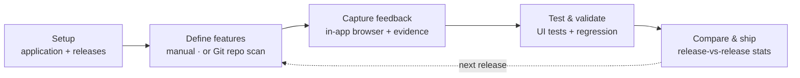
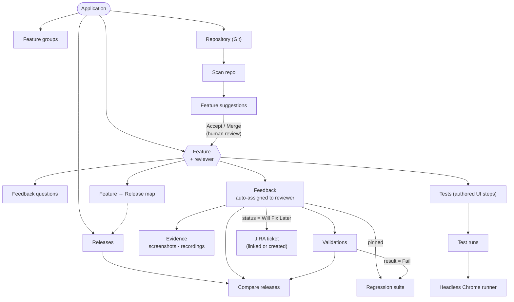
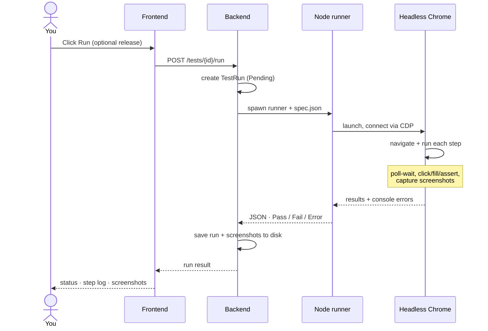

# FeaturePulse workflow

This document covers the end-to-end lifecycle, how the data model fits
together, what a UI test run actually does, and the known limitations of
the current implementation. For setup and configuration, see the
[README](../README.md).

## 1. The lifecycle

Everything in FeaturePulse is organized around a **Feature**. You catalog
features, capture feedback against them per release, verify them with
tests, and compare release health before shipping. The loop closes: each
release's results feed back into defining and testing the next one.

## 2. Data model

An **Application** owns releases, feature groups, a connected repository,
and features. A **Feature** is the hub everything else attaches to:
feedback, authored tests, feedback questions, and its mapping onto
releases.

Solid arrows are "owns / produces"; dashed arrows are references. Git
suggestions never enter the catalog automatically — they require **Accept**
or **Merge**.

## 3. Capturing feedback

1. Pick a feature (via the feature rail, or the global Feature filter).
2. FeaturePulse shows every prior report for that feature **across all
   releases** — not just the current one — so you can check whether
   something was already filed before you submit.
3. As you type a title, it's compared (word-overlap similarity) against
   those prior reports. A close match is flagged "Possible duplicate" with
   a match percentage, and floats to the top of the history list.
4. The feature's reviewer auto-fills as the assignee — visibly, in the
   form, so it can still be overridden.
5. Optionally preview the app under test in the in-app browser panel and
   attach a screenshot or screen recording as evidence.
6. Submit. The item is now searchable by feature, release, status, and
   application from the Feedback page.

The in-app browser is a sandboxed iframe: it renders pages that allow
framing (your own app, most dev/staging sites) but cannot load sites that
send `X-Frame-Options`/CSP framing restrictions (most third-party SaaS).
That's a browser security limit, not a FeaturePulse bug.

## 4. Reviewer triage

A feedback item's status drives the workflow:

| Status | Meaning |
|---|---|
| `Open` | Newly reported, not yet triaged |
| `In Progress` | Someone is actively working it |
| `Fixed` | Resolved by a code change |
| `By Design` | Not a bug — intended behavior |
| `Will Fix Later` | Deferred; see JIRA linking below |
| `Resolved` / `Closed` | Legacy terminal states, kept for backward compatibility |
| `Validation` | Awaiting regression validation |
| `Regression` | A regression validation failed against this item |

Marking an item **Will Fix Later** reveals a panel to either:

- **Create a JIRA ticket directly**, if the server has full JIRA
  credentials configured (`JIRA_BASE_URL`, `JIRA_EMAIL`, `JIRA_API_TOKEN`,
  `JIRA_PROJECT_KEY`) — this calls JIRA's REST API
  (`POST /rest/api/{2|3}/issue`) with the item's title, description,
  feature, release, severity and reporter, and stores the returned ticket
  key as a clickable link; or
- **Link an existing ticket** — paste a key or URL, with a "copy bug
  report" helper to paste into JIRA's own create screen when full API
  credentials aren't configured.

A failed JIRA API call surfaces JIRA's own error text and never marks the
item as linked — there's no silent false-success state.

## 5. Authored UI tests

A **test** is a named, saved sequence of steps tied to a feature and a
target URL. A **test run** is one execution of that sequence, recorded with
its own Pass/Fail/Error result, per-step log, console errors, and
screenshots. One test can have many runs over time.

Supported steps: `goto`, `wait`, `click`, `fill`, `waitFor`, `expectVisible`,
`expectText`, `screenshot`. Tests can be built in the visual step builder,
or imported in bulk — paste either a JSON array of
`{name, target_url, steps}` objects, or a simple line-based text format
(`test: <name>`, `url: <url>`, then one step per line).

### What happens on Run

The runner drives the system's installed Chrome over the DevTools Protocol
— no Playwright dependency. The first failing step marks the run `Fail`,
captures a failure screenshot, and stops; a crash or timeout (180s) marks
it `Error`.

### Egress allowlist

If `ALLOWED_TEST_HOSTS` is set on the server (comma-separated, `*.domain`
wildcards supported), tests may only target those hosts. This is enforced
twice: when a test is authored or imported (fails fast with a clear error
naming the blocked URL), and again inside the runner itself at every
navigation — including a `goto` step and any in-page redirect a `click`
might trigger. The runner-level check is the real boundary, since it's
what actually issues the network request. Leaving it unset keeps local
development frictionless.

## 6. Regression and release comparison

Any feedback item can be **pinned for regression** — it then appears in
the Regression suite, where a tester records a Pass/Fail/Blocked
**validation** against a specific release. A Fail flips the item's status
to `Regression`.

**Compare releases** shows two releases side by side: feature count,
feedback count, open count (`Open` + `In Progress` + `Regression` +
`Will Fix Later`), critical-severity count, and regression pass/fail
counts — enough to judge release readiness at a glance.

## Known limitations

This is a local-first prototype. Before pointing it at a real company
network with multiple teams, be aware of:

- **No per-user auth or RBAC.** A single shared `API_TOKEN` (if set) gates
  the whole API. There's no way to scope one team's applications away from
  another's, and no audit trail of who did what.
- **No secrets management for test credentials.** Login steps in an
  authored test (`fill #password = ...`) store the value as plain text in
  the database.
- **Single SQLite file by default.** No tenancy isolation; everything
  shares one database unless you switch to Postgres yourself and still
  manage isolation at the infrastructure level.
- **Synchronous test runs.** A run blocks its HTTP request for as long as
  the browser takes; there's no job queue or per-team concurrency limit.
- **Feedback questions have no answer-recording endpoint.** Questions can
  be defined per feature, but there's no API to record a response to one
  yet.
- **Private Git repository auth isn't stored.** Discovery scanning works
  against public HTTPS repos, or ones your server can already reach
  without extra credentials.
- **JIRA integration has no connection-test button yet** — the first real
  signal that credentials are wrong is the first failed ticket-creation
  attempt, which does surface JIRA's actual error message.
